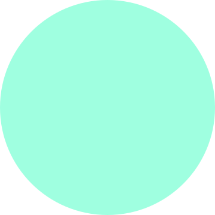

# Fuji

A multimedia file manager designed with privacy and precision in mind.

Made with
[Rust](https://www.rust-lang.org/),
[JS](https://developer.mozilla.org/en-US/docs/Web/JavaScript),
[Vue](https://vuejs.org/) and
[Vite](https://vite.dev/) in
[Tauri](https://tauri.app/).

### Workspaces

This repository is a pnpm monorepo: the application, the website, the Linux packaging, the Mac release through Apple, and steel and copper, two Rust crates the application depends on, the three Rust crates one Cargo workspace. The planning documents stay at the root.

```
./desktop           the Fuji desktop application, made with Tauri
./site              the website and documentation, made with VitePress
./linux             Fuji's Linux packages, built on a Mac through Docker
./apple             the Mac release, signed with a Developer ID and notarized by Apple
./steel             Fuji's safe Rust: the scout, its reader of a file's first bytes, and the walker of a folder tree
./copper            Fuji's Rust that needs neither Tauri nor a window and cannot be safe Rust: the calls into C and the operating system's libraries
```

### Scripts

Run `pnpm install` once at the root and it installs every workspace. Every other command runs from inside the workspace it belongs to, so start with `cd`. The root has no scripts of its own. pnpm comes from corepack rather than a global install, and reads the `packageManager` field in the root package.json to get the version this project pins.

```
$ pnpm install

$ cd desktop
$ pnpm local        run Fuji here, in development mode with hot reload
$ pnpm compile      build the binary in release mode, and stop there
$ pnpm installer    build the installer, all the way through the app to the dmg or the exe
$ pnpm reveal       open the file manager on that installer, to run it as a user would
$ pnpm hash         stage and hash what is already built, building nothing
$ pnpm upload       send what is already staged to the production server
$ pnpm certificate  find, make, or import the Mac's signing identity
$ pnpm notarize     build the installer signed with the Developer ID and notarized by Apple
$ pnpm library      build the media library from its pinned release sources, and write its entry in the ledger at the root

$ cd site
$ pnpm local        run the site here, in development mode with hot reload
$ pnpm build        build it to dist, to sanity check that works
$ pnpm upload       build it and send it to the production server

$ cd linux
$ pnpm library      build the media library for both architectures in Docker containers, into linux/cache and the ledger
$ pnpm build        build the Linux packages in Docker containers, from the library in linux/cache
$ pnpm hash         stage them and write the sidecars, building nothing
$ pnpm upload       send what is staged to the production server

$ cd apple
$ pnpm waiting-room build, notarize, hash and upload the Mac release, a key each

$ cd steel
$ pnpm test         run the scout's tests against its sample files and the walker's on the trees it builds
$ pnpm fuzz         run libFuzzer on the scout, seeded from the samples, until stopped

$ cd copper
$ pnpm test         run copper's tests, with nothing of Tauri compiled
```

Common flows through the desktop commands include:

- **local / compile** — work on a feature that doesn't involve desktop integration, and check the release build.
- **installer / reveal** — install Fuji the way a user does, and test file associations, the installed icon, and anything else that needs a real install.
- **installer / hash / upload / commit & push** — publish a release from Windows, then commit. Git tracks the sidecars. On the Mac this is the fallback, signed with Fuji's own certificate rather than Apple's.
- **notarize / hash / upload / commit & push** — publish the Mac release, signed with a Developer ID and notarized by Apple, then commit.

And through the site commands, there is really only one:

- **local / upload** — write or restyle a page with hot reload, then put it live. `upload` builds on its way out, so `build` is not a step in between.

We've picked unconventional script names to be clear about the smaller steps these commands perform. `compile` never makes an installer, `installer` never hashes, `hash` never builds, and `upload` never builds. The site's `upload` is the one exception, and builds before it sends.

A name does the same job on every machine. In `desktop`, `installer` makes a `.dmg` on macOS and a `.exe` on Windows, and `upload` sends whichever one the machine you're on can build — so you don't have to remember a different command per platform. On a Mac the dmg is made by [dmgbuild](https://github.com/dmgbuild/dmgbuild) through `uvx`, so the Mac that builds the installer needs [uv](https://docs.astral.sh/uv/) installed, and every Mac build links libmpv as the recipe builds it, so a Mac that builds at all needs the recipe's tools, `brew install meson ninja pkgconf`, and one `pnpm library` before its first build; `CLAUDE.md` says how the gather works. On Windows the exe is Fuji's own setup program, compiled with the Visual Studio C compiler that Rust already needs; the section The Windows installer says how. `linux` says `build` rather than `installer` because it makes four packages rather than an installer, but `hash` and `upload` mean exactly what they mean everywhere else.

And through the Linux commands:

- **build / hash / upload / commit & push** — the same shape as a desktop release, with the same three steps and the same reason for their being three.

And through the Apple waiting room, a key each:

- **b / n / h / u / commit & push** — build, notarize, hash and upload the Mac release, then commit. `./apple/README.md` is the guide, setting up a Mac included.

Steel and copper are the two workspaces that are Rust rather than JavaScript: crates of their own, which the application depends on by path and nothing publishes, and their commands are cargo's. Through them:

- **test / fuzz** — run its tests against its sample files and the folder trees they build, then let libFuzzer try millions of mutated files on it. `./steel/README.md` is the guide.

`pnpm icons` is separate from all of this. It rebuilds every platform's icons from the SVG sources. Run it by hand after you change the artwork, and after you upgrade the Tauri CLI, since the icons are committed files that an upgrade never regenerates.

The JavaScript behind these commands is in one file, `scripts.js`, at the root, and each command passes it a verb. Every workspace reaches it because they share facts: the published name of every artifact, where each one is built, and the file manager command for each platform. Those live in one table there. The Linux workspace has a second file, `linux/build.js`, which drives the containers — `scripts.js` publishes and does not build, and that one builds and does not publish. Every step of a build or a publish also writes a line to `build-log.txt` at the root as it starts and as it ends, through `build-log.js` beside `scripts.js`, so each machine keeps its own record of what it built and sent, and when.

### The build pipeline

Everything between a checkout and a download is the scripts below, and they run in three places: on the Mac natively, on the Windows box alone, and inside Docker Desktop's containers on the Mac, which are Linux. No Linux machine runs any of it. A release passes through them in one order on every platform: the media library is compiled from its sources, Tauri builds the application against it, a script of ours makes the installer, `hash` stages that under its published name with a sidecar beside it, and `upload` sends the pair to the server. This table is the map.

| path | runs | started by | does |
|---|---|---|---|
| `desktop/libmpv/libmpv.js` | Mac, Windows | `pnpm library` in desktop | checks the compilers and build tools are installed, installs MSYS2's on Windows the first time, and starts the recipe below |
| `desktop/libmpv/build.py` | Mac, Windows, and inside both Linux containers | `libmpv.js`, or `inside-tauri.py` in a container | downloads mpv, FFmpeg and the libraries under them, checks each against a hash written in the script, compiles them into the one media library, writes `libmpv.json` beside it, the record of what it made and where every part came from, and appends that record as an entry to the platform's library file at the root |
| `desktop/src-tauri/build.rs` | everywhere Fuji compiles | cargo, inside every Tauri build | links Fuji against the media library on the Mac and Linux, and gives the binary the path to find it at launch |
| `desktop/dmg.js` | Mac | `pnpm installer` after Tauri's build, and `notarize.js` | makes the dmg from the app Tauri built |
| `desktop/win-setup/win-setup.js` | Windows | `pnpm installer` after Tauri's build | packs the executable and the dll into a cabinet and compiles the setup program around it |
| `desktop/win-setup/registry.js` | Windows, inside the step above | `win-setup.js` | says which registry keys the uninstaller removes |
| `apple/notarize.js` | Mac | `pnpm notarize` in desktop | builds with the Developer ID, sends the app and then the dmg to Apple, staples their tickets, checks both with Gatekeeper, and puts the dmg in the bundle folder |
| `apple/waiting-room.js` | Mac | `pnpm waiting-room` in apple | the same work a key at a time, with a screen of where every application stands |
| `linux/build.js` | Mac | `pnpm library` and `pnpm build` in linux | copies a whitelist of the source into `linux/.stage`, brings the Docker images up to date, and runs the two Tauri containers at the same time, their lines prefixed by architecture: for `library` compiling the media library and appending each one's entry to its library file at the root; for `build` making the packages, with the flatpak container after them |
| `linux/inside-tauri.py` | inside the arm64 and the x86-64 container | `build.js` | for `library`, runs `build.py` and keeps the library and its record in `linux/cache`; for `build`, takes the library from the cache when its record names the staged recipe, refuses otherwise, runs Tauri's build, and copies the deb, the rpm and the record out to `linux/release` |
| `linux/inside-flatpak.py` | inside the flatpak container | `build.js`, once the x86-64 deb exists | unpacks that deb and lays it out as a flatpak |
| `scripts.js` | Mac, Windows | `pnpm hash`, `pnpm upload`, `pnpm reveal` and `pnpm certificate`, in desktop or linux | stages the finished package under its published name, writes the sidecar with the library's record inside, refuses a library the checked-out `build.py` did not make or one with no entry in its library file, and uploads each package with its sidecar |
| `build-log.js` | Mac, Windows | imported by the scripts above | writes a line to `build-log.txt` at the root as every step starts and ends |

The media library is compiled a few times a year and the application every release, and the four files at the root, `library-mac.txt`, `library-win.txt`, `library-amd.txt` and `library-arm.txt`, are the ledger of the library: every compile appends an entry saying when, from which sources checked against which hashes, with which compilers, under which recipe, and what came out, and `hash` refuses a package whose library has no entry. Between the library and the installer runs Tauri's own build, which is not ours. The three files beside `tauri.conf.json`, `tauri.macos.conf.json`, `tauri.windows.conf.json` and `tauri.linux.conf.json`, are read by it on their own platform alone and tell it to carry the media library into the bundle: as a framework on the Mac, a resource beside the executable on Windows, and under the program's folder on Linux, where that file also names the system libraries the deb and the rpm depend on.

Most of them are JavaScript, because Node is already on every machine for Tauri, runs on Windows where there is no bash, and hands a child process its arguments without a shell re-parsing them. `build.rs` is Rust because cargo runs it. The recipe and the two `inside` scripts are Python, which every build platform carries already because meson is written in it, and which keeps a table of sources, a stamp per package and a record of what it made far more plainly than a shell does; on Windows the recipe runs under MSYS2's own Python, the one that spells a path the way the configure scripts expect.

### Linux packages

Fuji's Linux packages are built **on the Mac, in Docker containers**, rather than on a Linux machine. `./linux/README.md` is the long version — the commands, and where every file lands on the way through. This is what an operator needs.

**Docker Desktop has to be installed and running.** The `docker` command is only a client, so if Docker Desktop is quit everything there fails with "cannot connect to the Docker daemon". `docker desktop status` says whether it is up and `docker desktop start` starts it without opening the window. Turn on **Use Rosetta for x86/amd64 emulation** in its settings while you are there; the x86-64 packages build in an emulated container and Rosetta is several times faster than the alternative.

After that it is three commands per release, and no setup step to remember:

```
$ cd linux
$ pnpm build        four packages and a recipe check, about eight minutes on the Mac mini
$ pnpm hash         stage them and write the sidecars, seconds
$ pnpm upload       send them to the server, seconds
```

Three rather than one because each leaves behind a different kind of thing. `build` writes packages, which are gitignored and disposable. `hash` writes sidecars, which are committed. `upload` puts files on a server, which is the only one of the three you can't take back.

**The first `build` on a new machine takes much longer**, because it builds three toolchain images before it builds anything else, which come to about 11 GB on disk. There is no separate setup command to forget: `build` brings its own images up to date every time, which costs three seconds once they exist. That also means you never have to notice when somebody bumps Rust or the Debian base in a `Dockerfile` and you pull it; the next build rebuilds that image and uses it.

`build` makes four things: a `.deb` for ARM, a `.deb` and an `.rpm` for x86-64, and a `.flatpak`. Four more commands sit underneath for factoring — `build-images`, `build-distro`, `build-flatpak` and `stage`. They're documented in the workspace and rarely typed.

### Publishing

**Two machines publish Fuji.** Windows builds and sends the exe. The Mac sends the dmg it built natively and had notarized through the apple workspace, and the four Linux packages it built in Docker containers — the ARM `.deb`, the x86-64 `.deb`, the `.rpm` and the Flatpak — so every Linux package comes from one machine, one base image and one lockfile rather than from a shelf of borrowed computers.

Linux is not a publishing machine, deliberately. You can clone this repository on Ubuntu or Raspberry Pi OS and run `pnpm installer` in `desktop` to build Fuji for the machine you're sitting at, which is development and works. Staging and uploading from there is refused, with a sentence saying why.

The site ships over rsync from any machine that has rsync, which in practice is the Mac. Windows can't, and says so clearly instead of failing somewhere deeper.

`hash` writes a small JSON sidecar next to each package holding its size, hash, version and date. No published name carries a version, and every Linux package states its architecture — `fuji.arm64.deb`, `fuji.amd64.deb`, `fuji.x86_64.rpm`, `fuji.x86_64.flatpak`. `fuji.dmg` and `fuji.exe` need no token, shipping one architecture each. That keeps every link anyone shares pointing at the current build instead of pinning the version that was current the day they shared it. Packages are gitignored and sidecars are committed. The download page fetches those sidecars when a visitor opens it, so a new installer shows up on the site as soon as you upload it, with no site deploy. If you skip `hash`, the upload compares the sidecar against the file next to it, sees they disagree, and stops.

Both `upload` commands read `.env` at the root for the server address and account details. The installer upload also needs an SSH key, belonging to a restricted account which can write the downloads directory and nothing else, while the site upload uses an administrative account. Neither the file nor the key is in git: `.gitignore` covers `.env`, and the key lives outside the repository. Set each machine up once from notes kept offline.

Downloading the installer from fujidesktop.app is different again. A browser marks a file it downloaded with the mark of the web, and that mark is what triggers SmartScreen on Windows. A copy you built locally carries no mark and runs without the warning.

### Scaffolded on macOS

The commands below are the original scaffolding from July 2025, kept as a record. Fuji moved from yarn to pnpm in August 2026.

```
$ yarn create tauri-app fuji
✔ Identifier · com.zootella.fuji
✔ Choose which language to use for your frontend · TypeScript / JavaScript - (pnpm, yarn, npm, deno, bun)
✔ Choose your package manager · yarn
✔ Choose your UI template · Vue - (https://vuejs.org/)
✔ Choose your UI flavor · JavaScript
```

The identifier in that transcript is what scaffolding proposed. Fuji's is now `app.fujidesktop.Fuji`, so the name it carries on every platform is the domain it publishes from rather than its author's.

### Output

Executable and installer on mac
```
./desktop/src-tauri/target/release/bundle/macos/Fuji.app
./desktop/src-tauri/target/release/bundle/dmg/Fuji_0.1.0_aarch64.dmg
```

Executable and installer on windows
```
./desktop/src-tauri/target/release/fuji.exe
./desktop/src-tauri/target/release/bundle/win-setup/Fuji_0.1.0_x64-setup.exe
```

Linux packages, built in containers from the `linux` workspace
```
./linux/release/Fuji_0.1.0_arm64.deb
./linux/release/Fuji_0.1.0_amd64.deb
./linux/release/Fuji-0.1.0-1.x86_64.rpm
./linux/release/Fuji_0.1.0_x86_64.flatpak
```

Staged for publishing by `pnpm hash`, on whichever machine built it. No published name carries a
version, and every Linux package states its architecture
```
./desktop/release/fuji.dmg              ./desktop/release/fuji.dmg.json
./desktop/release/fuji.exe              ./desktop/release/fuji.exe.json

./linux/release/fuji.arm64.deb          ./linux/release/fuji.arm64.deb.json
./linux/release/fuji.amd64.deb          ./linux/release/fuji.amd64.deb.json
./linux/release/fuji.x86_64.rpm         ./linux/release/fuji.x86_64.rpm.json
./linux/release/fuji.x86_64.flatpak     ./linux/release/fuji.x86_64.flatpak.json
```

Fuji ships those four packages and no more, so `bundle.targets` names them instead of Tauri's default `"all"`, which would also build an NSIS installer and an `.msi` on Windows and an `.AppImage` beside the Debian package. The installers themselves stay out of git; their sidecars are committed, so the repository keeps a dated record of what hash each release had.

`pnpm reveal` opens whichever of those bundle folders this platform builds into, so there is no need to walk the path by hand.

### The two names

Fuji has two names, and the code keeps them apart with two words. **`brandName`** is the name people read, `Fuji`. It's on the window, the Mac's menu bar and `Fuji.app`, the Windows Start menu and installed apps list, and in every sentence the app shows. **`brandStem`** is the stem of the executable's name, `fuji` of `fuji.exe`. It names the executable, the settings file `fuji.toml`, the log folder, and the published installers like `fuji.dmg`. Neither is made from the other, since a product called Candy Crush might be `candycrush` or `candy-crush` inside.

To rename the app, or to make a fork of it your own, set them in two files:

- **`desktop/src-tauri/tauri.conf.json`** — `productName` is `brandName`. Beside it are the other fields a fork changes. `identifier`, `app.fujidesktop.Fuji`, is a third name with jobs of its own: it's what the Mac knows the app by, the folder WebView2 keeps its data in on Windows, and the Flatpak's name. Then `bundle.publisher`, `copyright`, `homepage`, and the two descriptions. And in `bundle.resources`, the Start tile's manifest is copied out as `fuji.VisualElementsManifest.xml`. That's `brandStem` written out, because Windows only finds the file under the executable's name, and a JSON file can't read it.
- **`desktop/src-tauri/Cargo.toml`** — the package `name` is `brandStem`, since Cargo names the executable from it. Beside it are `description`, and `authors`, which becomes the maintainer listed in the Linux packages. The library's name, `fuji_lib`, is `brandStem` written out again, and `src/main.rs` calls it, so change the two together.

Everything else reads those two files. Tauri names every build from them. The Rust code has both in its package info, as `name` and `crate_name`. The page reads both in `desktop/src/brand.js`, which has the long version. The build scripts, `desktop/dmg.js`, `desktop/win-setup/win-setup.js`, `scripts.js` and `linux/build.js`, read them for themselves; `win-setup.js` compiles both into the Windows setup program, and `linux/build.js` hands them to the Flatpak container, which can't see either file. `Cargo.lock` follows on the next build.

After a rename, search `desktop`, `linux` and `scripts.js` for the old name, leaving out `node_modules`, `target` and `dist`. What turns up should be comments, the prose of `linux/README.md`, and the sidecars of past releases in the two `release` folders, which a fork deletes rather than renames. The website is separate: it says Fuji in its own words, and spells the published installer names out in its own code.

Two addresses go with the names, both written bare, with no scheme. **`urlHome`** is the site, `fujidesktop.app`, read from `bundle.homepage`. **`urlHelp`** is where Fuji Help in the Help menu sends a person, `fujidesktop.app/help`. That's a page on the site, `site/docs/help/index.md`, which forwards to wherever help lives. A copy of the app in the field may never update, so it keeps this address for good, and the site decides where it leads. Both are set in `desktop/src/brand.js`, and a fork whose help lives somewhere else writes its own address there.

### The Windows installer

On Windows, Fuji's installer is a small program of its own, in `desktop/win-setup/`, rather than one Tauri makes. A user double-clicks `fuji.exe`, and about a second later Fuji is running, with nothing shown in between. It installs for the current user alone, into `%LOCALAPPDATA%\Fuji`, writes one Start menu shortcut and the entry Settings lists under Apps, and starts Fuji. The same program, saved beside Fuji as `uninstall.exe`, is the uninstaller.

It exists for the upgrade. Fuji registers itself with Windows while it runs, offering to open its file types, and a user who chooses Fuji for a type in Windows' Default apps saves a choice that only Windows' own screens can write. An installer that uninstalls the old copy before installing the new one takes Fuji's registrations away for a moment, and Windows throws the user's choice away with them. This installer writes the new files over the old ones and touches no registration, so an install over an existing copy keeps every choice. An uninstall does take Fuji's registrations back, so a reinstall after it starts clean.

**Building it.** `pnpm installer` runs `win-setup.js` after `tauri build`. It reads the two names, the version, the identifier and the icon from `tauri.conf.json` and `Cargo.toml`; stages `fuji.exe` and the files `bundle.resources` names, read from `tauri.conf.json` with `tauri.windows.conf.json` merged over it as Tauri merges it, into one folder; packs them into a cabinet with Windows' own `makecab`; writes `build/stamp.h`, the header holding everything the setup program knows but its uninstall list, and `build/uninstall.h`, that list an entry to a line, which only `setup.c` reads; compiles `setup.c` with `build.cmd`, which finds the Visual Studio C compiler; and appends the cabinet and a 24-byte trailer to the compiled program. The result lands in `src-tauri/target/release/bundle/win-setup/`, where `pnpm hash` finds it.

**Running it.** The setup program reads its own trailer to find the cabinet, ends any Fuji running from the install folder, unpacks the cabinet over whatever is there, writes `uninstall.exe`, the uninstall entry and the shortcut, and starts Fuji. Uninstalling ends a running Fuji, takes back what Fuji wrote to the registry, its listing in Settings and its offer for each extension listed in `registry.js`, removes the shortcut, the entry and the folder, and leaves the user's settings in `fuji.toml` and the web view's data, in the folder named for the identifier, alone.

Every file in `win-setup/` except `registry.js` is written for any Tauri app and names no product: each reads the names it needs from `tauri.conf.json` and `Cargo.toml`, so nothing there changes when Fuji does. A few of `setup.c`'s comments describe an app with more parts than Fuji, a helper process it starts, a lock file, and a named pipe through which a running copy can be asked to exit. Fuji has none of them, and the code needs none: asking through the pipe fails at once, and the setup program ends a running Fuji instead, which loses only the settings changed since that Fuji started. `registry.js` is the one file with Fuji's own content, its list of extensions, which repeats the enabled types in `fileTypes.js` the way `Info.plist` does.

## Setup macOS

Verify or Install Xcode Command Line Tools
```
$ xcode-select -p
/Library/Developer/CommandLineTools

$ xcode-select --install
```

Confirm you can reach Apple's Clang compiler, aliased as gcc
```
$ gcc --version
Apple clang version 17.0.0 (clang-1700.0.13.5)
Target: arm64-apple-darwin24.5.0
Thread model: posix
InstalledDir: /Library/Developer/CommandLineTools/usr/bin
```

Install Rust
```
$ curl https://sh.rustup.rs -sSf | sh
$ rustc --version
rustc 1.88.0 (6b00bc388 2025-06-23)
$ cargo --version
cargo 1.88.0 (873a06493 2025-05-10)
```

On the Mac that publishes, import the signing certificate. `pnpm certificate` says whether the login keychain holds the identity `tauri.conf.json` names, and `pnpm certificate import <backup.p12>` brings the original onto a new Mac; the signing essay in `scripts.js` says why there's only ever one. `pnpm installer` signs with it, while `pnpm local` and `pnpm compile` don't sign and don't need it.

## Setup Windows 10

https://visualstudio.microsoft.com/visual-cpp-build-tools/
 * Downloads and runs a 4.5mb installer
 * Visual Studio Installer, wizard starts
 * Desktop development with C++, choose that one first card

You can paste the whole block below into *PowerShell* as a single command
```
# Detect Visual Studio Build Tools with MSVC
$vsPath = & "C:\Program Files (x86)\Microsoft Visual Studio\Installer\vswhere.exe" `
  -latest -products * `
  -requires Microsoft.VisualStudio.Component.VC.Tools.x86.x64 `
  -property installationPath
# Locate MSVC toolset folder
$msvcRoot = Join-Path $vsPath "VC\Tools\MSVC"
# Get the latest MSVC version folder
$latestMsvcVersion = Get-ChildItem $msvcRoot | Sort-Object Name -Descending | Select-Object -First 1
# Build full path to cl.exe
$clPath = Join-Path $latestMsvcVersion.FullName "bin\Hostx64\x64"
# Output the resolved path
Write-Host "Resolved cl.exe path:"
Write-Host $clPath
```
Should output a path like
```
Resolved cl.exe path:
C:\Program Files (x86)\Microsoft Visual Studio\2022\BuildTools\VC\Tools\MSVC\14.44.35207\bin\Hostx64\x64
```
You only need to get it on the path for this one *PowerShell* session...
```
# Add cl.exe to the path for this session, and confirm it's there
$env:Path += ";$clPath"
Get-Command cl.exe

CommandType  Name    Version    Source
-----------  ----    -------    ------
Application  cl.exe  14.44.3... C:\Program Files (x86)\Microsoft Visua...
```

...to be able to then install the Rust toolchain
```
# Install the Rust toolchain
Invoke-WebRequest -Uri https://win.rustup.rs -OutFile rustup-init.exe
Start-Process .\rustup-init.exe
```
This pops its own command line window, *Enter* for default

Now you can see everything in [Git](https://git-scm.com/downloads/win)'s *MINGW64*
```
$ node --version, v22.21.1
$ npm --version, 10.8.1
$ corepack --version, 0.34.0
$ rustc --version, rustc 1.98.0 (88d9e12ae 2026-08-18)
$ cargo --version, cargo 1.98.0 (797e8a9bc 2026-08-05)
$ git --version, git version 2.55.0.windows.3

$ git clone https://github.com/zootella/fuji
$ cd fuji
$ pnpm install --frozen-lockfile
$ cd desktop
$ pnpm installer
$ pnpm local
```
`pnpm` isn't installed globally — it comes from corepack, which ships with Node. Run `corepack enable` once from an elevated *PowerShell*; after that `pnpm` reads the `packageManager` field in the root package.json and runs the exact version this project pins, downloading it on first use. Use `--frozen-lockfile` when you're installing what's committed rather than changing dependencies; it refuses to quietly rewrite pnpm-lock.yaml, which is what keeps one lockfile serving both mac and windows.

No global `tauri-cli` either — the `@tauri-apps/cli` in devDependencies is what `pnpm local` and `pnpm installer` run, and keeping it there means the CLI can't drift out of step with the Rust crates.

## README from scaffolding

**Tauri + Vue 3**
This template should help get you started developing with Tauri + Vue 3 in Vite. The template uses Vue 3 `<script setup>` SFCs, check out the [script setup docs](https://v3.vuejs.org/api/sfc-script-setup.html#sfc-script-setup) to learn more.

**Recommended IDE Setup**
- [VS Code](https://code.visualstudio.com/) + [Volar](https://marketplace.visualstudio.com/items?itemName=Vue.volar) + [Tauri](https://marketplace.visualstudio.com/items?itemName=tauri-apps.tauri-vscode) + [rust-analyzer](https://marketplace.visualstudio.com/items?itemName=rust-lang.rust-analyzer)
