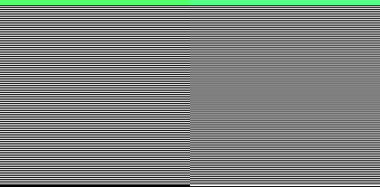

# Image Fidelity

A picture viewer's job is to show a picture sharp, in the colors its file says, at once, and without the window stalling while it does. Fuji shows pictures three ways. The ***contact sheet*** is a folder seen whole, hundreds of thumbnails down one scroll. The ***light table*** is one picture at a time on a plane you pan and zoom, and Fuji's is the [Diamond Table](./diamond-table.html). The ***preview*** is the picture a double-click in Finder or Explorer opened, alone in a window shaped like it. On all three, a picture is decoded by code the platform already trusts, shrunk by a filter chosen for the job, and sized to the grid the screen is painted in, so that the last step to the screen is a copy. This page is how, on macOS, Windows and Linux, and why each step is done the way it is.

Fuji is a desktop application built in two halves. A Rust program owns the window, the files, and anything the operating system will do on Fuji's behalf; a web page draws everything the user sees, rendered by [WebKit](https://webkit.org) on macOS, [Chromium](https://www.chromium.org) on Windows and [WebKitGTK](https://webkitgtk.org) on Linux. [Tauri](https://tauri.app) joins the two and carries calls and bytes between them. Nearly every decision below comes down to which half should do a piece of the work.

Fuji's words for its own parts:

- **Contact sheet** — one folder seen whole, its pictures in **buckets** down one scroll. Fuji's code calls it the sheet.
- **Light table** — one picture at a time, on a plane the user pans and zooms around. Fuji's code calls it a table, and the rectangle the picture fills on it the **card**.
- **Tile** — one thumbnail as it sits on the contact sheet: either a `<canvas>` Fuji painted or an `` the engine draws.
- **Beam** — the length every thumbnail is measured against, in CSS pixels, which the user picks from Small, Medium, Large and XL.
- **Fit** — the rule that measures a picture against the beam, which the user picks for the whole sheet.
- **Store** — the one place Fuji keeps a file's bytes and its decoded picture. It hands them out and takes them back when told, and decides nothing on its own.

Four pixel units are at work. **Image pixels** are the picture's own. **CSS pixels** are what a page is laid out in and what the user sizes things in. **Backing pixels** are the grid the engine paints, `devicePixelRatio` of them to each CSS pixel across: 1 on an ordinary monitor, 2 on a Retina Mac, and 1.25, 1.5 or 1.75 on Windows at those scales. **Panel pixels** are the display's lights. Fuji's rule is that a picture is brought from image pixels to backing pixels by code Fuji chose, and that nothing resamples it after that: the backing pixels reach the compositor one to one. How backing pixels become lights is settled after Fuji has finished, by the operating system and the display settings, and [the last section of the Ben Day page](./ben-day.html#one-image-pixel-one-light) says how.

## Two decoders

Two libraries can decode a picture on a Mac or a Windows PC, and Fuji uses both. One is the web engine, which decodes for an ``, inside its sandbox, choosing its decoder by the file's bytes. The other is the operating system's own imaging library, the one Finder and Explorer draw their thumbnails with: [ImageIO](https://developer.apple.com/documentation/imageio), which arrived with Mac OS X Tiger in 2005, and the [Windows Imaging Component](https://learn.microsoft.com/en-us/windows/win32/wic/-wic-about-windows-imaging-codec), WIC, which arrived with Windows Vista in 2006. Fuji calls those from Rust, and they decode in Fuji's own process. Linux has only the engine, because its desktops and distributions differ too much in what they carry for Fuji to lean on any library of theirs.

Before an imaging library decodes anything, Fuji reads the picture's size from the header through it and refuses a picture whose raster would not fit in half the machine's memory. That is the defense against a decompression bomb, a file of a few hundred bytes whose header claims billions of pixels, which needs no bug in anything to work, since a decoder believes a header before it finds out otherwise. The wall is a share of the machine, not a fixed number, so it grows with the hardware, and it stands in front of the imaging library because that is the decoder running outside any sandbox. The engine's own decodes, for the page route and the light table, have no wall in front of them; the engine's sandbox contains a picture claiming an impossible size. The wall also refuses a picture whose size the library will not say, since without a size Fuji cannot work out how large to draw it.

Which decoder a file goes to is written in one table in Fuji's source, by extension and by platform, and each view chooses from it in its own way:

| | contact sheet, from the imaging library | contact sheet, from the engine | light table, from the imaging library |
| --- | --- | --- | --- |
| macOS | every raster format Fuji opens: JPEG, PNG, BMP, WebP, AVIF, HEIC, TIFF, Targa, PICT, Photoshop, and the camera raws DNG, CR2, NEF and ARW | none | Targa, PICT, Photoshop and the camera raws |
| Windows | JPEG, PNG, BMP and TIFF | WebP, AVIF, and BMP named `.dib` | TIFF |
| Linux | none | JPEG, PNG, BMP and WebP | none |

Everything else on a light table is the engine's ``, and a GIF or an SVG is the engine's `` on every view and every platform.

**The contact sheet asks the imaging library first**, because a thumbnail comes back from it small: the library decodes a JPEG at as little as an eighth of its size where the codec allows, shrinks it the rest of the way on one of Rust's threads, and hands the page only the small pixels. **The light table asks the engine first**, because its flip is built on the engine's decoded ``, and it turns to the imaging library only for what the engine cannot read, a TIFF on Windows or a Photoshop file on a Mac.

Each list is conservative, and Fuji never goes past it. Windows gets the formats WIC decodes on a stock install, and none it reads only through an extension from the Microsoft Store, which a machine may not have, so WebP and AVIF go to the engine there, which always reads them. A format with no decoder on a platform is not listed in a folder there at all. Fuji does not probe for codecs: the table is a decision written down in the code, and a capability negotiation would give a different answer on every machine. Which formats Fuji opens, and the history of each, is the [File Types page](./file-types.html).

The decoders underneath have far more range than these lists. ImageIO on a current Mac decodes some sixty types, including thirty-odd camera raw formats; WIC on a stock Windows install handles JPEG, PNG, GIF, BMP, TIFF, ICO, JPEG XR and DDS, with WebP, AVIF and HEIC arriving as store extensions; and Chromium's own decoders cover JPEG, PNG, GIF, WebP, BMP, ICO and AVIF. The two platforms come out opposite. On macOS the imaging library is the more capable side and the engine adds only SVG; on Windows it is the other way round for the formats the web was born with.

## One picture at a time

The light table and the preview each show one picture, and they show the same element.

**The store reads the file through Rust, raw.** A Tauri command that returns a byte vector serializes it as a JSON array, one decimal number per byte, written on one side and parsed on the other, at about a hundred and fifty milliseconds a megabyte, flat and linear in file size, which no disk is. Fuji's read returns a response that crosses as an `ArrayBuffer` instead, in single-digit milliseconds. The store wraps those bytes in a blob typed by the extension, since WebKit refuses a TIFF in a blob with no type, makes one object URL over it, points an `` at the URL, and awaits [`decode()`](https://developer.mozilla.org/en-US/docs/Web/API/HTMLImageElement/decode), which makes the full-size frame off the main thread. That decoded `` is the finished picture, and every view shows that one element: the preview shows it, and a click hands it to the light table's card, because a second element pointed at the same picture would cost the whole decode again. The URL is kept for as long as the picture is held, because an engine may drop a hidden element's decoded frame, and a URL that still points at the bytes lets it rebuild the frame from memory instead of the disk.

**A picture only the imaging library can read arrives as a canvas.** Rust decodes it at its own size, turns it upright and converts it into the screen's color space, the page paints those pixels once onto a canvas, and the store holds the canvas where the `` would be. The light table and the preview show it as they show an ``. Its pixels are the canvas's own bytes, which the engine cannot drop and rebuild. And a canvas has a ceiling an `` does not: both engines cap a canvas at about 268 million pixels, the area of a square 16,384 on a side, so a TIFF on Windows larger than that, an A3 page scanned at 1200 dots to the inch, is decoded whole and then cannot be shown.

**The light table holds a window of the folder.** The five pictures behind the one on the card and the five ahead of it, at the factory settings of `flip.back` and `flip.forward` in `fuji.toml`, are read and decoded before the user flips to them, four reads at a time, in the order they were asked for. So a flip shows a picture already decoded, and its order is fixed: wait for a frame boundary, show the next element and hide the last, wait for that paint to reach the screen, and only then ask the store for the picture that has come into the window. A read or a decode started any sooner would hold the main thread, the thread that has to paint the frame the flip is waiting for, so nothing new is asked for until the picture is on the screen.

**The card lands on the backing grid.** The light table keeps where everything should be in real numbers that are never rounded, and snaps the card's size and place to whole backing pixels every time it writes them to the page, so no edge falls on a fraction of a pixel and no rounding piles up from one zoom to the next. The card is the picture's own shape, and the picture fills it with [`object-fit`](https://developer.mozilla.org/en-US/docs/Web/CSS/object-fit) of `fill`, which stretches nothing. The engine resamples the decoded frame once, from image pixels to the card's backing pixels, and the compositor copies the card to the screen one to one. On a Mac, where `devicePixelRatio` is 1 or 2, every whole CSS pixel is a whole number of backing pixels, and on a Retina screen every half CSS pixel is one too, so snapping to backing pixels rather than CSS pixels keeps every position the display can show. At Windows' fractional scales the two grids stop nesting, and the card stays on backing pixels while its size in CSS pixels reads 33.333, not 33. The card's frame is an outline, drawn outside its box, because a border would be drawn inside it and squeeze the picture two pixels short.

**The keys are exact.** `1` to `6` show the picture at that many CSS pixels per image pixel, so `2` makes every pixel of the file two CSS pixels across. `F` fits the whole picture inside the screen, and `W` fits its width. The wheel and a right drag zoom along one curve, which the [Zoom page](./zoom.html) describes. `R` swaps the engine's smoothing for blocks of the picture's own pixels, which the [Ben Day page](./ben-day.html) works through ratio by ratio. And `I` shows the zoom in CSS pixels and in backing pixels per image pixel, so the ratio is always in view.

**The preview's window is the picture.** Fuji takes the title bar off and fits the window around the picture: its own shape, as large as the part of the desktop the menu bar, dock and taskbar leave free, placed away from the pointer, and never more than two CSS pixels per image pixel, so a small picture does not fill the screen with enlarged pixels. The window is a whole number of CSS pixels, and `object-fit` of `contain` takes up the fraction of a pixel that rounding leaves, so no edge of the picture is cut off. A click turns it into the light table, with the card where the preview's picture stood.

**Nothing resizes a picture unless Fuji says so.** Tailwind's reset, which Fuji keeps for evening out three engines' defaults, gives every `` a `max-width` of 100%, which shrinks a picture wider than its container and has the engine resample it without any code asking. Fuji's stylesheet cancels the rule, so every `` sets its own size, and one that forgot would show at its own size, a mistake anyone can see, rather than a resample nobody notices.

## A folder at a time

A folder can hold hundreds of pictures, and Fuji can assume nothing about any of them. One may be a sixteen-pixel icon of a few hundred bytes. The next may be 6240 by 4160, six megabytes on disk and 6240 × 4160 × 4 bytes once a decoder undoes the compression, a hundred and four megabytes of raster for one picture. Two hundred of those on screen at once would be twenty gigabytes.

### Why every thumbnail is a canvas

The obvious answer, `` tags and letting the engine worry about it, is better than it sounds. Both engines decode a large picture small when they know it will be painted small, called *subsampling*. Chromium decodes a JPEG at a half, a quarter or an eighth of its size for a small paint. WebKit subsamples by a rule of its own: the level for a draw is the power of two nearest the reduction, and the deepest level allowed is the first at which the frame falls under five million pixels, so a 6240 by 4160 raster is decoded at a quarter of its width, 1560 by 1040, and a 4000 by 3000 one at a half. An `` thumbnail is therefore far smaller than a full decode in both engines. A wall of images that scrolls is the most ordinary thing on the web, and the engines have spent twenty years making it work.

So the case for Fuji doing the work itself is about who owns the bytes, not how many there are. An ``'s decoded pixels are the engine's to keep or to drop, on a byte budget it does not publish and that covers everything else the page holds as well. Under the budget, showing a hidden picture again takes about fifteen milliseconds. Over it, the engine throws the frame away, and showing that picture again means reading and decoding the file from scratch, a quarter of a second for a large one. Fuji cannot ask what the budget is or how much of it is spent, and the engine says nothing when it drops a frame, so the only move Fuji would have is to hold less and hope that is enough.

A canvas works the other way round. Its size is set in backing pixels, and when Fuji sets one to 480 by 320 the engine allocates 480 × 320 × 4 bytes, 600 kilobytes, and gives Fuji a surface to paint on. Fuji draws the thumbnail in and lets go of the file it came from, so those bytes are the only copy, and the engine cannot drop them, since it would have nothing to rebuild them from. They stand for as long as the canvas element stands, and nothing else frees them, however hard the machine is squeezed for memory. What Fuji gets for that is a number it can work out before it opens a file:

| beam | one thumbnail | two hundred of them |
| --- | --- | --- |
| Small, 120 px | 150 KB | 30 MB |
| Medium, 240 px | 600 KB | 120 MB |
| Large, 360 px | 1.35 MB | 270 MB |
| XL, 480 px | 2.4 MB | 480 MB |

For a picture three units wide by two tall under the factory fit, on a Retina Mac, where a [`devicePixelRatio`](https://developer.mozilla.org/en-US/docs/Web/API/Window/devicePixelRatio) of 2 makes each CSS pixel two backing pixels across. On Windows at 150% the same numbers are a little over half of these.

Two hundred Medium thumbnails come to a hundred and twenty megabytes where two hundred full decodes would be twenty gigabytes. The saving matters less than it looks, since the engine was never going to hold twenty gigabytes either. What matters is that Fuji knows the figure. So **every raster thumbnail in Fuji is a canvas**, whichever decoder made its pixels, and Fuji adds their bytes up as it goes: each bucket's caption says what its thumbnails cost, and a report beneath the last bucket sets the total beside what Fuji's processes take and what the machine has.

### The fork

Every file on the contact sheet goes down the same two decisions:

<div style="overflow-x:auto;margin:2rem 0">
<svg viewBox="0 0 640 366" role="img" aria-label="A file's extension chooses an img tile or a canvas tile, then the platform's list chooses which decoder fills the canvas" style="width:100%;min-width:480px;max-width:640px;height:auto;font-family:var(--vp-font-family-base, system-ui, sans-serif)">
	<defs>
		<marker id="forkArrow" viewBox="0 0 10 10" refX="9" refY="5" markerWidth="6" markerHeight="6" orient="auto-start-reverse">
			<path d="M 0 1 L 9 5 L 0 9 z" fill="currentColor" fill-opacity="0.45" />
		</marker>
	</defs>
	<g fill="none" stroke="currentColor" stroke-opacity="0.45" marker-end="url(#forkArrow)">
		<path d="M 170 62 L 170 96" />
		<path d="M 170 142 L 170 186" />
		<path d="M 170 242 L 170 286" />
		<path d="M 310 119 L 372 119" />
		<path d="M 310 214 L 372 214" />
	</g>
	<g fill="none" stroke="currentColor" stroke-opacity="0.28" rx="6">
		<rect x="30" y="16" width="280" height="46" rx="6" />
		<rect x="30" y="100" width="280" height="42" rx="6" />
		<rect x="30" y="190" width="280" height="52" rx="6" />
		<rect x="30" y="290" width="280" height="60" rx="6" />
		<rect x="372" y="91" width="240" height="56" rx="6" />
		<rect x="372" y="186" width="240" height="56" rx="6" />
	</g>
	<g fill="currentColor" font-size="14" text-anchor="middle">
		<text x="170" y="44">one file path from the folder</text>
		<text x="170" y="127">is it a GIF or an SVG?</text>
		<text x="170" y="214">is the format on this</text>
		<text x="170" y="233">platform&#39;s native list?</text>
		<text x="170" y="316">the page decodes the file</text>
		<text x="170" y="336">and halves it down</text>
		<text x="492" y="114">an img tile: the engine draws</text>
		<text x="492" y="134">the file itself, at any size</text>
		<text x="492" y="209">the operating system decodes</text>
		<text x="492" y="229">it already scaled</text>
	</g>
	<g fill="currentColor" fill-opacity="0.65" font-size="12">
		<text x="180" y="170">no, so a canvas tile</text>
		<text x="180" y="268">no</text>
		<text x="318" y="113">yes</text>
		<text x="318" y="208">yes</text>
	</g>
</svg>
</div>

The last question names the two routes the rest of this section turns on: the ***native route***, where the operating system's imaging library decodes the file and Fuji paints the pixels it returns, and the ***page route***, where the web engine decodes it and the page shrinks it by hand. Linux is not a third branch. Its native list is empty, so every raster file there takes the page route, which makes the page route the only one of the two that works on all three platforms, and the one that has to keep working. On macOS nothing takes it, since ImageIO reads every raster format Fuji opens.

**A GIF or an SVG is an ``.** A GIF goes to an `` because only an `` animates, and a picture that moves in a browser should move on the contact sheet too. Drawn into a canvas it would be its first frame, a perfectly good thumbnail and what most file managers show, but Fuji would rather show the thing itself. A contact sheet of two hundred animations sounds expensive, and it is not: an animation runs only while it is in view, so a wall of GIFs costs only the handful on screen. An animated WebP, PNG or AVIF is a still, its first frame, because a tile is chosen by its extension, before anything has read whether the file moves.

An SVG goes to an `` because it has no pixels to own: the engine paints it sharp at whatever size the page gives it, and one without intrinsic dimensions gives a canvas nothing to scale a drawing to, so it cannot go the other way at all. An `` shows an SVG as an image rather than as a document, so its scripts never run, it loads nothing from outside itself, it receives no events, and the element clips it, so it cannot draw over its neighbors however its coordinates are written. That makes it safe to show one this way, and it is why Fuji never shows one inline in its own page, where those scripts would run as Fuji.

### How big

Every tile is sized from the picture's own size in image pixels, by the fit the user chose, against the beam. The beam is one length for the whole sheet, 120, 240, 360 or 480 CSS pixels for Small, Medium, Large and XL at the factory. Six of the fits each measure a picture one way: by its longer side, its diagonal, its width plus its height, the square root of its area, its height, or its width. Each scales the picture until that measure matches the same measure of a reference picture, 4:3 and the beam wide. The other two keep pictures' sizes relative to one another, so a big scan is big and an icon is small. The factory fit is SquareFit, the longer side, which is what Finder and Explorer do. The reference is 4:3 because that is 800 by 600, the screen of a PC in the 1990s, and the shape an iPhone shoots its photographs in today, so the commonest pictures in a collection come out the same size under most fits.

Every fit keeps three promises. **A picture is never enlarged**: one smaller than its fit shows at its own size, an image pixel to a CSS pixel. **Fuji crops nothing**: every tile is a whole picture, and the rows come out ragged because of it. And **the size is whole CSS pixels**, at least one each way, because that is the grid the engine lays a box out on.

The fits are written twice, once in the page's JavaScript and once in Rust, and for the same picture the two give the same answer, to the integer, on every machine. Rust needs them because the native route learns a picture's size partway through one call, from the header the library reads just before it makes the thumbnail, and has to choose the size to render at right then; the page needs them to size every tile. Both languages do the arithmetic in IEEE 754 double precision, where adding, subtracting, multiplying, dividing and taking a square root are correctly rounded by the standard itself, so the same operations in the same order give the same bits in both. Anything a platform's math library computes its own way, a power, a logarithm, `hypot`, is kept out, which is why the diagonal is one square root. A test checks the Rust against the JavaScript's answers for more than five hundred picture sizes under every fit: every size must match, and every scale to the bit. Close is not enough, for the reason under [One backing pixel](#one-backing-pixel).

### The operating system's route

The native route is one call, which opens the file once. The page sends Rust the path, the fit, the beam, the screen's size and `devicePixelRatio`. Rust opens the file through the library, reads its size and orientation from the header, checks the size against the memory wall, runs the fit, and asks the library for the thumbnail at the fit's CSS size times `devicePixelRatio`, rounded the way the page rounds the canvas it will paint, and never more than the picture's own pixels. The library reads the file itself, a buffer at a time, so the page never holds it, and the work runs on Tauri's pool of threads, never on the thread that runs the window.

On macOS the code is short, because ImageIO does the whole job in one call given three options: the longer side to scale to, a flag to render from the full picture rather than handing back whatever small preview the file may carry, and a flag to apply the file's EXIF orientation. Fuji then draws the result into a bitmap context of the color space the page asked for, and that draw is where [Core Graphics](https://developer.apple.com/documentation/coregraphics) does the color management. A picture with an alpha channel is the one exception: ImageIO hands it back whole, decoded and turned, and the same draw does the shrink, for the reason under [Edges](#edges). One loop afterwards undoes the *premultiplied alpha* a drawing context produces, colors pre-scaled by their own opacity, which have to be divided back out before the pixels mean what `ImageData` expects.

On Windows the code is long, because WIC is a pipeline of separate objects, each initialized over the last: a decoder over the file path, its first frame, a scaled decode through the codec's own [source transform](https://learn.microsoft.com/en-us/windows/win32/api/wincodec/nn-wincodec-iwicbitmapsourcetransform) where it offers one, the [Fant scaler](https://learn.microsoft.com/en-us/windows/win32/api/wincodec/ne-wincodec-wicbitmapinterpolationmode) for the rest of the way, a flip-rotator for the EXIF orientation that WIC leaves to the caller, a color transform from the file's profile to sRGB, and a format converter to straight-alpha RGBA. Nothing runs until the final `CopyPixels`, which pulls the whole pipeline.

Both perform a *scaled decode*: a baseline JPEG comes out at a half, a quarter or an eighth of its size by skipping most of the inverse transform, and baseline is the ordinary case, so for an ordinary JPEG the full-size raster never exists. They differ in one thing that matters below. WIC takes the width and the height exactly, so its thumbnail is the size the page will paint to the pixel. ImageIO takes only the longer side, and rounds the shorter one itself.

Either way one buffer comes back. Its bytes, by offset:

```
0-3     the thumbnail's width, little-endian u32
4-7     the thumbnail's height
8-11    1 if the pixels are Display P3, 0 if they are sRGB
12-15   the picture's own width as it shows, after its orientation
16-19   the picture's own height, the same way
20-     straight-alpha RGBA, top row first, 4 bytes a pixel
```

The header carries the picture's own size, not the fit's answer, so the page runs the fit itself, as it does on every route. The buffer crosses as one `ArrayBuffer`, for the same reason the store's read does.

### The page's route

For everything else, WebP, AVIF and `.dib` on Windows and every raster file on Linux, the page does it. The store reads the file and decodes it into an `` as it does for the light table, and the page draws that element down into the canvas and lets it go, so the store can drop the bytes, the URL and the full-size decode the moment the canvas has the pixels. The canvas never holds more pixels than the file does: its size is the fit's CSS size times `devicePixelRatio`, or times the picture's own pixels per CSS pixel where those are fewer.

**The page shrinks by halves.** A single [`drawImage`](https://developer.mozilla.org/en-US/docs/Web/API/CanvasRenderingContext2D/drawImage) from a full-size decode into a small canvas comes out rough on the Mac: fine repeating texture in a 6240 by 4160 raster turns to jaggies at 240 CSS pixels, where Safari shows the same file smooth as an ``. Two engine behaviors cause it, and they compound. *Core Graphics*' high interpolation reads a fixed footprint of source pixels around each output pixel, and at twenty-six to one that leaves most of the picture unread, and unread pixels alias. And WebKit hands `drawImage` a subsampled frame only when it has to decode one: a frame already decoded at full size counts as good enough for any smaller request, and the store's `decode()` produces exactly that frame, so the engine hands `drawImage` all twenty-six million pixels, where it hands Safari's ``, which never calls `decode()`, a sixteenth of them.

So the page halves through two scratch canvases, taken in turn, until the last draw is within two to one, the ratio at which a fixed footprint is a true average of its source. Every step sets [`imageSmoothingQuality`](https://developer.mozilla.org/en-US/docs/Web/API/CanvasRenderingContext2D/imageSmoothingQuality) to `high`, since the default, `low`, reads only the four nearest source pixels and would alias even at that ratio. Chromium's `high` is itself a chain of successive halvings sampled with a cubic filter, which reads everything, so on Windows the halving is work the engine would have done anyway.

[`createImageBitmap`](https://developer.mozilla.org/en-US/docs/Web/API/Window/createImageBitmap) looks like the purpose-built tool here: ask it for `resizeWidth` and `resizeQuality` and it decodes straight to the size wanted, and on Chromium it does. WebKit has the code and does not ship the options, so on macOS it returns a full-size bitmap, a whole second copy of a large raster, allocated for nothing and then scaled by the same `drawImage` that could have done the job alone. So Fuji does not use it.

### Filling a sheet

Every tile in a bucket is asked for at once, and each waits in the line of the part of the machine it taxes, which lets four through at a time in the order they were asked for, so a bucket fills from the top. A native tile waits in the line for Rust's threads, since its decode never touches the page. A page tile waits in the line for the web engine, and keeps its place there while the store reads the file, because from the read to the release it holds a whole file and its full-size decode. Four of those at once is a few hundred megabytes for a moment when they are large photographs, which a present-day desktop has to spare. Every read waits in the line for the disk.

Fuji reads nothing ahead of a thumbnail. A tile takes its room on the contact sheet when its pixels arrive, so the first thumbnails appear at once and the rows settle as the rest fill in. A file its decoder refuses is left out and counted in its bucket's caption, and nothing is tried twice.

The contact sheet is a window onto every picture on the drive as one list, each folder's pictures in order and then its subfolders', the order `find` would walk it, and it holds one page of that list: `sheet.buckets` buckets of `bucket.images` pictures each, which Previous and Next move along a page at a time. So the most thumbnails Fuji ever holds is a number in `fuji.toml`, however large the drive.

## Speed

Measured outside the app on an Apple M2, macOS 15.7, one image at a time, third run of three, thumbnail longest side 480. The native column is the operating system's route timed from a scratch binary. The web columns are the page route's exact code run in a headless WKWebView: `decode` is the element's decode, `main` is what the halving cost the main thread, and `complete` is when the pixels were finished in whichever process drew them. All in milliseconds.

Six large JPEGs, all progressive, 0.4 to 6.2 MB on disk:

| raster | native | web decode | web main | web complete |
| --- | --: | --: | --: | --: |
| 6240 × 4160 | 48 | 971 | 224 | 260 |
| 4096 × 4096 | 17 | 80 | 52 | 76 |
| 4105 × 3079 | 22 | 217 | 86 | 104 |
| 3629 × 2419 | 78 | 143 | 80 | 86 |
| 2455 × 3068 | 73 | 123 | 74 | 80 |
| 3299 × 2199 | 57 | 106 | 59 | 64 |

The native column does not follow raster size; these six differ in bytes as much as in pixels, and neither measure explains their order. All six are progressive JPEGs, where a scaled decode saves least, because every scan has to be entropy-decoded before any scaling helps, so this table understates the native route's lead on ordinary baseline JPEGs.

The same six re-saved as baseline JPEGs at web sizes, which is most of what a folder actually holds:

| source | native | web decode | web main | web complete |
| --- | --: | --: | --: | --: |
| 1600 px, 120–680 KB | 6–9 | 10–15 | 1–2 | 11–18 |
| 1000 px, 57–270 KB | 3–4 | 5–7 | 0–1 | 4–6 |

For web-sized pictures both routes are fast and the native one is about three times quicker on the clock. A folder of two hundred fills in a few seconds either way, and the window drops no frames.

For the large rasters the picture changes. The native route is three to twenty-five times faster, and the halving costs the main thread fifty to two hundred and twenty milliseconds an image, which is a dropped frame or a dozen, per picture, while a folder of large images fills. The cost comes from the scratch canvases forcing the engine to finish each step before the next one reads it; a lone draw into a canvas costs the main thread nothing, because the engine defers it.

**Responsiveness ranks above total time.** A person who waits a second for a folder while Fuji stays completely responsive is far better off than one who waits the same second while Fuji stutters. The native route costs the main thread nothing at all, because the decode runs on a pool thread and the page receives only small pixels. That, more than the multiplier, is why the operating system goes first wherever Fuji lets it.

### Whether WIC's scaled decode engages

On Windows the question is whether the scaled decode happens at all, since it sits behind two conditions that fail silently: the codec offering [`IWICBitmapSourceTransform`](https://learn.microsoft.com/en-us/windows/win32/api/wincodec/nn-wincodec-iwicbitmapsourcetransform), and `GetClosestSize` returning something smaller than the frame. If either fails, the Fant scaler reduces from the full raster and nothing says so. Measured on Windows 10 with Intel UHD Graphics 630, against a 6000 × 4500 baseline JPEG:

| | |
| --- | --: |
| *WIC* forced to a full decode, 6000 × 4500 | 213 ms |
| *WIC* asked for a scaled decode to 240 px | 62 ms |
| Fuji's own thumbnail of that file, decoded alone | 65 ms |

It engages: Fuji's cost sits on the scaled figure, nowhere near the full one. The first two rows come from *WPF*'s `BitmapDecoder`, which wraps the same *WIC*, with `DecodePixelWidth` set or not and the pixels copied out to force the work, so the question goes to the library directly instead of being inferred from Fuji. The last is one image alone in a folder, since a reading taken while a folder fills carries the other thumbnails' contention in it.

A more obvious experiment gives the wrong answer. Timing a JPEG against a PNG of identical dimensions looks like the natural control, since *WIC*'s PNG codec cannot scale and must reduce from the full raster, but the two come out within a few milliseconds of each other, and that is not evidence of anything. A scaled decode skips the inverse DCT and the upsampling; it cannot skip the Huffman pass, which reads every coefficient in the file. That pass is most of the 62 ms, and the PNG's inflate-and-unfilter is most of its own cost: two large unavoidable costs of similar size, hiding the saving between them.

## Between the file and the screen

A picture can come out of all that the wrong size, soft, fringed, sideways, in the wrong colors or in the wrong light, and each has its own cause and its own answer. Everything in this section was measured on hardware where it does not say otherwise, because several of these faults are invisible on an ordinary sRGB monitor, where a CSS pixel and a backing pixel are the same thing.

### Size

The fit decides a tile's size in CSS pixels, and the light table's keys decide the card's. Never enlarged is a promise about the bitmap, not about the screen: a picture smaller than its fit keeps its own pixels, one image pixel to a CSS pixel, as an `` would, so on a Retina screen the engine stretches each of its pixels across two backing pixels. That is the `` tag's own rule, kept on purpose, so a small picture shows at the size its maker saw it on every screen.

### One backing pixel

The engine lays a canvas out on whole CSS pixels and paints it in backing pixels, so the box it occupies on screen is a whole number of CSS pixels times `devicePixelRatio`. If the bitmap is not exactly that many backing pixels, the compositor cannot *blit* it one to one, copying each pixel straight onto the screen. It resamples it instead.

Because the fits agree to the integer in both languages, the native route stays out of this: Rust renders at the size the page will paint, and WIC delivers that size exactly, as does Core Graphics where it does the shrink. ImageIO, told only the longer side, rounds the shorter one itself, and can land a backing pixel short. A picture of 6240 × 3497 under the factory fit, at the Medium beam, on a Retina Mac:

```
fit      css   = 240 × round(134.5) = 240 × 135
box      css × 2                    = 480 × 270 backing pixels
ImageIO  3497 × 480 / 6240 = 269.0  = 480 × 269                 one row short
```

The long axis always survives, since it is the box by construction. The short axis is ImageIO's own rounding, which disagrees with the page's about half the time, so on a Retina panel half of all native thumbnails on a Mac would sit in a box one backing pixel taller or wider than they have pixels for, and the compositor would resample every row.

That resample is not a soft edge. The phase between source and destination rows drifts from zero at one end of the picture to a full pixel at the other, passing through exactly half a pixel in the middle, where every output row is the mean of two source rows.

Measured on a Retina, Display P3 MacBook Air at a `devicePixelRatio` of 2, macOS 26.2, with two test images authored at exactly the size the thumbnailer returns, so neither is resampled on the way in, each carrying one-pixel black and white rows. The figure is the share of pixels that came back neither near-black nor near-white:

| tile | canvas sized to the picture | canvas sized to the box |
| --- | --: | --: |
| 480 × 268, even short side | 0.11% | 0.00% |
| 480 × 269, odd short side | 89.91% | 0.00% |

Sized to the picture, the odd tile decays from clean alternating rows at the top to a flat `rgb(128,128,128)` at its midpoint, the pattern erased entirely, and recovers toward the bottom. On a continuous-tone image that is softness; on any fine repeating detail it is a total collapse of contrast. The even tile is the control, and its two figures are not a result: its geometry is the same under both rules, and the 0.11% against the 0.00% comes from two different kinds of screen capture rather than from anything on the page.

**Fractional CSS does not fix this**, though it looks as though it should. Giving the element a height of `backing / devicePixelRatio` un-rounded is legal, and the engine honors it exactly: `style 134.5px`, `computed 134.5px`, a layout rectangle of 134.5. The odd tile still reads 90.74% intermediate. Padding the bitmap instead, against a whole-pixel CSS height, drops it to zero. A fractional CSS box does not buy a backing-pixel-exact blit in WebKit.

**So Fuji sizes each canvas to the box the compositor will use**, not to the picture, and puts the picture in the corner of it:

```js
function flowSnap(side, have) {
	let backingPerCss = window.devicePixelRatio
	let want = Math.round(side * backingPerCss)
	return want > have + backingPerCss ? have : want
}
```

That tolerance, `have + backingPerCss`, separates two cases. A thumbnail shrunk to fit misses its box by at most one backing pixel of rounding, and taking that sliver buys a one-to-one blit for every row, so Fuji takes it, and repeats the picture's last row and column into it, making the seam the picture's own color rather than a transparent line. A picture smaller than its box misses it by far more than that and is meant to, since the fit leaves such a picture at its own size and the engine enlarges it the way an `` would; that one keeps the pixels it has.

Two things follow. The rule does nothing where a CSS pixel is one backing pixel, so an ordinary monitor behaves as it would without it. And it does nothing on the page route, where the canvas is derived from the CSS size and the two cannot disagree. The rule rests on how WebKit and Chromium lay out and composite a canvas, which they do consistently and which no specification promises.

A canvas is made for the screen it is on. Fuji does not make the contact sheet's canvases again when a window moves to a screen of another `devicePixelRatio` or another gamut, so they keep the first screen's backing pixels and color space until the contact sheet rebuilds.

### At Windows' fractional scales

On macOS `devicePixelRatio` is only ever 1 or 2, so a whole-CSS box is always a whole number of backing pixels and Fuji can always size a canvas to it exactly. Windows offers 125%, 150% and 175%, where it is fractional and a whole-CSS box lands on a fraction of a backing pixel: at 150%, a box of 135 CSS pixels is 202.5 backing pixels, and a canvas can be 202 or 203 but not 202.5. Windows has one pixel unit fewer than macOS, since it keeps no backing store apart from the display resolution, and pays for the simpler model with worse arithmetic.

Measured on Windows 10 at 1920 × 1200, across four runs covering all three fractional scales, by the method above: PNGs authored at exactly the size the thumbnailer returns, carrying one-pixel black and white rows, read back off the screen rather than out of the canvas. Every canvas came out the size the rule predicts, and roughly a quarter of the tiles were resampled anyway.

**How far a canvas misses its box matters more than which side it misses on.** A miss of a quarter of a backing pixel was almost always clean; a miss of a half or three quarters resampled far more often, whether the canvas was over or under. That is why the rule rounds: rounding bounds the miss at half a backing pixel in either direction, and nothing can do better, because the box is not a whole number of backing pixels and no canvas can sit on it.

Flooring looks like the improvement, so that the canvas never overshoots its box and the compositor has nothing to resample, and in those four runs every canvas smaller than its box was clean. But every one of those was short by exactly a quarter of a backing pixel, because that is what rounding produces. Flooring produces misses of a half and three quarters, and at 175% against the same eleven files it fixes two tiles and breaks three, one of them in a row sitting squarely on the backing grid:

| bitmap | canvas, rounding | result | canvas, flooring | result |
| --- | --: | :-- | --: | :-- |
| 210 × 200 | 200 | clean | 199 | **resampled** |
| 210 × 204 | 205 | clean | 204 | **resampled** |
| 210 × 205 | 205 | clean | 204 | **resampled** |
| 210 × 206 | 207 | resampled | 206 | clean |
| 210 × 207 | 207 | resampled | 206 | clean |

**Where a tile sits matters as well**, and follows no rule simple enough to state. A tile's place on the backing grid depends on every row above it, since row heights accumulate in halves and quarters at a fractional scale. At 150% the rows began at 45, 310.5 and 579 backing pixels and every failure was in the middle one; at 125% they began at 38, 315.5, 595.5 and 878, and every failure was in the two fractional ones. Across the four runs that pattern has exceptions in both directions, tiles on a fractional row that stayed clean and tiles on a whole row that did not. The resampling that remains belongs to laying a grid out in whole CSS pixels on a fractionally scaled display, and no choice about the size of a canvas can put a row on the backing grid.

The failure looks just like the Retina one: down a resampled tile the luma walks from a clean 248/8 at the top toward a flat 128/128 at the midpoint, the phase drifting a full pixel across the picture.



Two tiles from one contact sheet at 175%, cropped from a screen capture at their exact size. Both files are the same test pattern of alternating one-pixel black and white rows, and both thumbnails were made by the same code in the same run; the green band is a marker the test images carry so each tile can be identified. Neither canvas sits exactly on its box, because at this scale none can. The left one is a **quarter** of a backing pixel over its box, 205 against 204.75, and every row was blitted one to one anyway. The right one is a **half** over, 207 against 206.5, and every row was resampled.

Read the right tile from the top down and the phase drifts a full pixel across it: aligned and crisp at the top, half a pixel out and flat gray through the middle where each output row is the mean of two source rows, then a whole row out and crisp again at the bottom, where it is also inverted, the black rows landing where the left tile's white ones do. Sampled down one column, its luma walks 11, 60, 110, 134, 184, 233 while the left tile holds 0 all the way.

**This picture only works at its own size.** Alternating one-pixel rows turn to gray under any resampling at all, so a browser scaling this image down renders both halves gray and shows nothing. If both tiles look the same here, the page is not displaying it one to one. That fragility is the same arithmetic that makes a thumbnail one backing pixel out look soft, not merely smaller.

### Edges

A PNG keeps a color for every pixel, a clear one too, and most programs store black there. A correct shrink weighs each color by its opacity, so a clear pixel's hidden color counts for nothing. A shrink that averages the colors alone lets the hidden one into every outline, a dark fringe around a logo that the eye reads as a cheap scan.

ImageIO's resample averages the colors alone. On a Mac mini under macOS 27.0.1, its thumbnail of the Firefox logo, as Wikimedia renders the logo to a PNG, carries 1,215 near-black partly clear pixels at 210 pixels across, where a correct shrink has 1. A white disc on clear pixels that hide bright green comes back with 1,104 green-tinted ones. So on a Mac a picture with an alpha channel comes back from ImageIO whole, and Core Graphics shrinks it as it draws it into the bitmap context. A drawing context holds premultiplied pixels, each color already multiplied by its own opacity, where a clear pixel's color is zero whatever the file kept under it, so the shrink weighs by opacity without being asked. Whether a picture has an alpha channel is read from its header, 0.2 milliseconds for an 8000 by 6000 JPEG, and a picture without one keeps ImageIO's scaled decode.

WIC's Fant scaler weighs by opacity already. On Windows 10, against a premultiplied area average of WIC's own full decode, its thumbnail of the same logo at 210 pixels is darker by more than 40 levels a channel at only eight edge pixels, each at an opacity of 1 or 2 in 255, where eight bits of premultiplied color keep almost nothing. The green-hidden disc comes back without one green pixel. On the page route every step of the halving draws into a canvas, which both engines keep in premultiplied pixels, so it weighs by opacity the same way; that route is read from how the engines store a canvas rather than counted.

### Orientation

A phone stores a portrait as a landscape raster and a tag in its EXIF saying how to turn it. ImageIO applies the tag when asked. WIC leaves it to the caller, and Fuji applies it with WIC's flip-rotator, which takes one set of flags for both operations and applies the flip first. Six of EXIF's eight cases carry a rotation or a flip but not both, so the order cannot matter. Only 5 and 7, the mirrored diagonals, carry both, and a flip then a quarter turn differs from a quarter turn then that flip by a half turn, so for those two Fuji turns the other way round the circle. Eight sample JPEGs store one raster, red over blue, each tagged with a different orientation, and Fuji's tests check on both platforms that the red half lands where the tag says, so the answer is a position rather than anyone's judgment of what upright looks like. On the page route and on the light table the engine applies the tag itself. Every route sends back the picture's size as it shows, after its orientation, so a portrait's tile is tall.

### Color

A canvas is sRGB unless the page asks for something else, and `drawImage` converts its source into the canvas's color space on the way in. Any color the source holds that sRGB cannot express, `drawImage` moves to the nearest color sRGB can, and a file tagged Display P3 holds plenty of them. Nothing afterwards records what the original value was; the canvas holds the moved one. On a wide-gamut screen the thumbnail would then look duller than the light table shows the same file.

Fuji's answer has three parts, each in a different layer.

**The page asks the screen, not the engine.** The [`color-gamut`](https://developer.mozilla.org/en-US/docs/Web/CSS/@media/color-gamut) media query reports what the display can show, and Fuji creates every canvas in that space. Asking the engine by name instead would be a feature check: Chromium accepts `display-p3` everywhere, and WebKit compiles that value only into its Apple builds, so on WebKitGTK the value does not exist and passing it throws. Asking the screen avoids the question: a wide-gamut panel gets a wide canvas, an ordinary screen gets the sRGB canvas it always had, and the engine that has no such value is never asked for one.

**Rust converts and then says what it converted to.** The operating system's route draws each picture into a bitmap context of the space the page asked for, and reports in the buffer's header which space it actually delivered. macOS delivers what it was asked for. WIC answers sRGB whatever is asked, because it has no Display P3 context without a profile file, and the header says so.

**The page tags the pixels with what the header said**, so a wide-gamut canvas converts Windows' sRGB pixels rather than reading them as wide values.

Measured on the MacBook Air with three PNGs authored so that *Core Graphics* performed every conversion and nobody typed a value in by hand. The first two are split down the middle: on the left a primary that lies outside sRGB, on the right sRGB's own primary written in P3 coordinates, so one half is outside sRGB's gamut and the other inside it. On a correct pipeline the halves differ visibly; if anything clamps, they become identical.

| image | what Rust returned | canvas read as `display-p3` | canvas read as `srgb` |
| --- | --- | --- | --- |
| P3 red halves | `(255,0,0)` / `(234,51,35)` | `(255,0,0)` / `(234,51,35)` | `(255,0,0)` / `(255,0,0)` |
| P3 green halves | `(0,255,0)` / `(117,251,76)` | `(0,255,0)` / `(117,251,76)` | `(0,255,0)` / `(3,255,0)` |
| sRGB red control | `(234,51,35)` both halves | `(234,51,35)` | `(255,0,0)` |

Every value matches the file exactly. The sRGB readings are what a correct pipeline gives: pure P3 red is outside sRGB, so it clips when asked for in sRGB, while the in-gamut half maps back to the `(255,0,0)` it was born as. The green pair round-trips three units off in one channel, which is the expected cost of two conversions at eight bits.

The control runs the other way, and it matters as much: Fuji must *convert* an sRGB file into P3 coordinates rather than reinterpret it as P3, or every ordinary picture on the contact sheet would come out oversaturated. It converts correctly both ways.

Captured from the screen rather than read back from the canvas, the contact sheet shows two distinct clusters per hue in equal counts, and the sRGB control lands on the same value as the P3 file's in-gamut half, two different encodings of one physical color arriving at the same value. If anything in the chain reinterpreted where it should convert, or converted where it should reinterpret, that is the pair that would come apart. The light table, showing the same file at full size through the engine's ``, shows the same two clusters, 878,906 pixels each. And the page route's code, run on the same three images, produced values identical to the operating system's route to the last unit. So Display P3 survives from the file to the glass by every route: through ImageIO, through the engine's decode and its `drawImage` into a P3 canvas, and through an `` on a table.

On Windows the question is narrower. WIC converts to sRGB and says so in the header whatever the page asked for, so the one thing to check is whether a file carrying a profile arrives converted at all, or whether its profile is ignored. It arrives converted. Windows ships `sRGB Color Space Profile.icm`. Swapping the offsets its tag table gives `rXYZ` and `gXYZ` produces a valid profile that says the red channel sits at green's chromaticity. Two PNGs were written with byte-identical pixels, thirds of `(200,0,0)`, `(0,200,0)` and `(0,0,200)`, one carrying that profile in an `iCCP` chunk and one carrying nothing:

| | left third | middle | right third |
| --- | --- | --- | --- |
| no profile | `191,0,0` | `62,200,0` | `20,9,204` |
| swapped profile | `62,200,0` | `191,0,0` | `20,9,204` |

Red and green trade places as the profile says they should, and blue is the control that did not move, because `bXYZ` was never touched. Neither row holds the authored numbers, because the capture passes through the machine's own monitor profile, which is why the evidence is the two rows against each other rather than either row against `(200,0,0)`.

WIC's sRGB costs something only on a wide-gamut Windows panel: there a Display P3 photograph that WIC decodes, a TIFF on the light table or a JPEG on the contact sheet, loses its colors outside sRGB before the page sees the pixels, and the header says sRGB. The engine's ``, which shows every other picture on a Windows table, does its own color management.

### Light

Gamma is a lens over every picture Fuji shows, one SVG filter on every tile and on the picture a table shows, applied to the finished pixels: the canvases keep what they were painted with, the store keeps its decode, and nothing is read, drawn or decoded again when it changes. Off means no filter at all, not an exponent of 1, so a picture at rest is exactly what this page measures. The [Gamma page](./gamma.html) is the whole account.

Gamma reaches every resample as well. Averaging encoded values is not averaging light: black and white average to 128 as codes, where half of white's light encodes to about 188 in sRGB. The compositor's resample of the stripes above goes to a flat `rgb(128,128,128)`, the encoded average, and the operating systems' scalers and the engines average encoded values too, so every downscaled thumbnail carries a subtler version of the same darkening in fine, high-contrast detail. [Averaging in the wrong space](./gamma.html#averaging-in-the-wrong-space), on the Gamma page, says why every scaler does it that way and what averaging in linear light costs.

### Moiré

A scanned page of comics is a grid of dots photographed onto a grid of pixels, and showing it smaller is sampling it again, onto a third grid. A shrink that picks pixels rather than averaging them makes the dots beat with that grid. ImageIO's resample and WIC's Fant read every source pixel, and so does the page's chain of halvings. Two shrinks read a footprint that does not grow with the ratio instead: Core Graphics', which shrinks a picture with an alpha channel on the Mac in one step, and the engine's own, the one the light table resamples with, which `R` turns to nearest neighbor. The [Ben Day page](./ben-day.html) works through what each does to a page of dots, and the ratios at which the blocks come out exact.

## How these were measured

Every figure on this page is a count against a known answer or a difference between two measurements, never a judgment, and the test images are what make that possible: each is made for one question. For sharpness, a picture made at exactly the size the thumbnailer returns, so nothing resamples it on the way in, carrying one-pixel black and white rows, and the share of pixels that come back neither black nor white. For color, two halves of one picture, the same hue inside sRGB and outside it, and only whether the halves still differ. For orientation, one raster tagged eight ways, and which half the red lands in. For edges, a white disc on clear pixels hiding a color no edge should show, and the count of pixels that show it.

The pixels are read in the layer the question is about. A canvas is read back with `getImageData` in an explicit color space, both `display-p3` and `srgb`, which is what separates a wide value that survived from one that was clamped and happens to look similar. What reaches the screen is read from a capture of one window's own buffer, and two regions are only ever compared within one capture, since two kinds of capture disagree by a unit. A capture is tagged with the display's profile, so comparing two halves of one screenshot leaves the profile out of the answer; and on a machine with a monitor profile installed a capture does not return the values the page painted at all, so a color test there has to be two files that should differ from each other, never one file against a number typed into the test.
